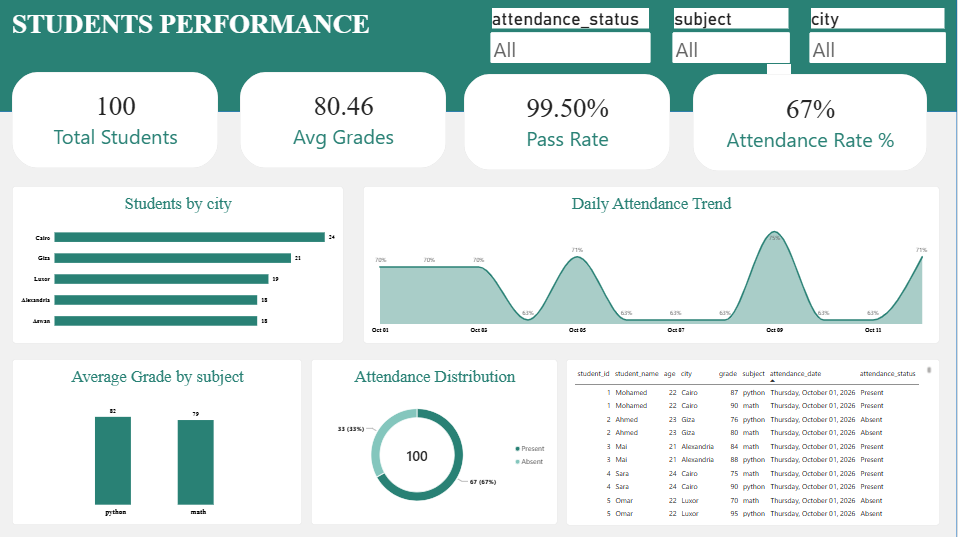

# 🎓 Student Performance ETL Project

An end-to-end ETL project that extracts student data from **MongoDB**, transforms it with **Python**, loads it into **SQL Server**, and visualizes the results in **Power BI**.

## 🏗️ Project Architecture

**MongoDB → Python ETL → SQL Server → Power BI**

## 📊 Dashboard Preview



**Key numbers from the dashboard:**

| Metric | Value |
|---|---|
| Total Students | 100 |
| Average Grade | 80.46 |
| Pass Rate | 99.5% |
| Attendance Rate | 67% |

## 📁 Project Structure

```text
etl-student-performance/
│
├── mongo/
│   └── insert_data.js
│
├── sql/
│   └── create_table.sql
│
├── etl/
│   └── etl_pipeline.py
│
├── powerbi/
│   ├── dashboard.pbix
│   └── dashboard.png
│
└── README.md
```

## 🗄️ 1. MongoDB Source

Database: `university`

Collections:

- `students`: student information.
- `grades`: student grades.
- `attendances`: attendance records.

Example student document:

```json
{
  "student_id": 1,
  "name": "Ahmed",
  "age": 20,
  "city": "Cairo"
}
```

## 🐍 2. Python ETL

The Python script performs three main steps:

1. **Extract:** Read data from MongoDB.
2. **Transform:** Clean the data, validate grades, and normalize attendance statuses.
3. **Load:** Insert the transformed data into SQL Server.

Install the required packages:

```bash
pip install pymongo pyodbc
```

Run the ETL script:

```bash
python etl/etl_pipeline.py
```

## 🏢 3. SQL Server Target

Database: `universityDWH`

Create the target table:

```sql
CREATE DATABASE universityDWH;
GO

USE universityDWH;
GO

CREATE TABLE dbo.StudentPerformance (
    student_id INT,
    student_name NVARCHAR(100),
    age INT,
    city NVARCHAR(100),
    subject NVARCHAR(100),
    grade INT,
    attendance_date DATE,
    attendance_status NVARCHAR(20)
);
```

Check the loaded data:

```sql
SELECT *
FROM dbo.StudentPerformance;
```

## 📈 4. Power BI Dashboard

Connect Power BI Desktop to SQL Server using **DirectQuery** and load `dbo.StudentPerformance`. All measures are calculated from this single table, so no extra views or relationships are needed.

### Dashboard Design

- **KPI Cards:** Total Students, Average Grade, Pass Rate, Attendance Rate.
- **Bar Chart:** Average Grade by Subject.
- **Bar Chart:** Students by City.
- **Donut Chart:** Attendance Distribution (Present vs. Absent).
- **Area Chart:** Daily Attendance Trend.
- **Table:** Student Details.

### Slicers

- Attendance Status
- Subject
- City

### DAX Measures

**Total Students**

```dax
Total Students =
DISTINCTCOUNT(StudentPerformance[student_id])
```

**Average Grade**

```dax
Average Grade =
AVERAGE(StudentPerformance[grade])
```

**Pass Rate**

Assuming 50 is the passing grade:

```dax
Pass Rate % =
DIVIDE(
    CALCULATE(
        COUNTROWS(StudentPerformance),
        StudentPerformance[grade] >= 50
    ),
    COUNT(StudentPerformance[grade]),
    0
)
```

**Attendance Rate**

```dax
Attendance Records =
DISTINCTCOUNT(StudentPerformance[student_id])

Present Records =
CALCULATE(
    [Attendance Records],
    StudentPerformance[attendance_status] = "Present"
)

Attendance Rate % =
DIVIDE([Present Records], [Attendance Records], 0)
```

Format `Pass Rate %` and `Attendance Rate %` as **Percentage** in Power BI.

> **Note:** Each student has one row per subject, so counting rows would double the attendance numbers (134 present / 66 absent instead of 67 / 33). Counting distinct `student_id` values avoids this, assuming each student has one attendance record per day.

## 🎯 Project Goals

- Extract data from MongoDB.
- Transform and clean data using Python.
- Load data into SQL Server.
- Analyze grades and attendance using SQL.
- Build an interactive Power BI dashboard.

## ✅ Final Result

A simple end-to-end data engineering project:

**MongoDB → Python → SQL Server → Power BI**
